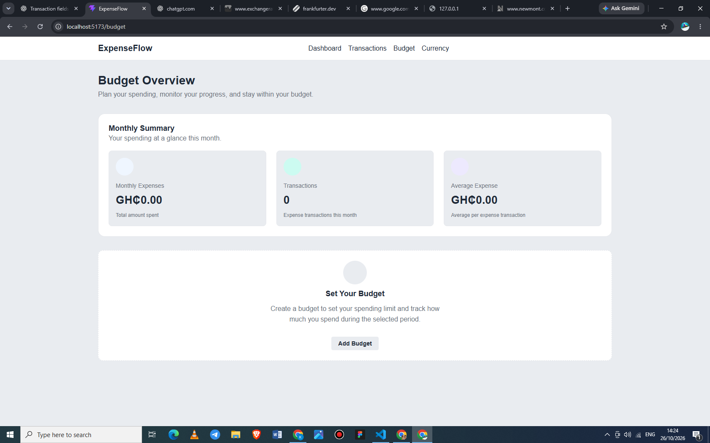
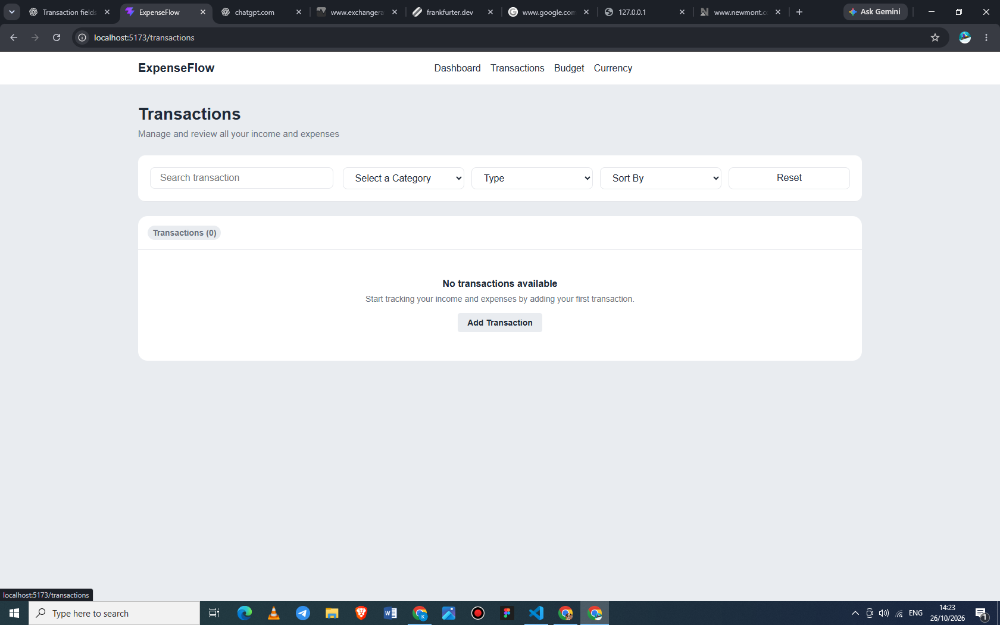
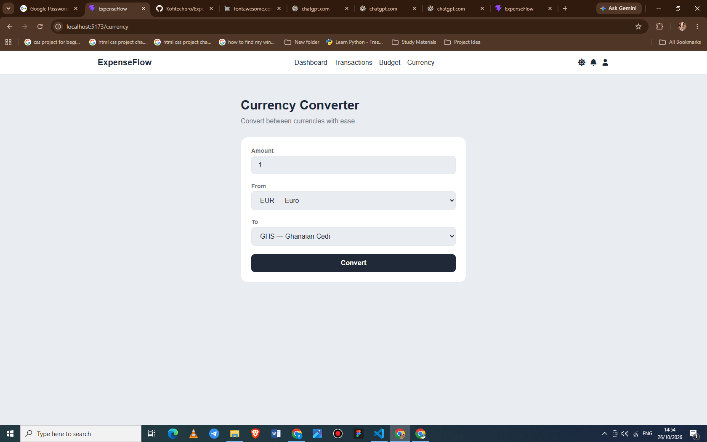

# ExpenseFlow

### Personal Finance & Budget Management Application

ExpenseFlow is a React-based personal finance application designed to help users track income and expenses, manage budgets, and monitor spending patterns through a centralized dashboard.

The project demonstrates practical frontend development skills, including component-based architecture, state management, client-side routing, data persistence, and responsive user interface development.

## Overview

Managing personal finances requires a clear understanding of income, expenses, and spending habits. ExpenseFlow brings these activities together in one interface, allowing users to record financial transactions, organize expenses, and review budget-related information.

Built as a hands-on development project, ExpenseFlow reflects an iterative approach to learning, problem-solving, and applying modern frontend development practices.

## Key Features

### Dashboard

- View financial summaries, including balance, total income, and total expenses.
- Review key financial information from a centralized interface.




### Transaction Management

- Create, view, edit, and delete financial transactions.
- Organize transactions by category and transaction type.
- Search transactions using available search controls.
- Filter transactions by category or type.
- Sort transactions by date or amount.




### Budget Management

- Create budgets for specified periods.
- Edit existing budget details.
- Delete budgets when they are no longer needed.
- Review spending against a budget's date range.
- View monthly expense summaries, transaction counts, and average expenses.


### Currency Conversion

- Convert between supported currencies using exchange-rate data from the Frankfurter API.




### Data Persistence

- Persist supported transaction and budget data using browser local storage.
- Retain saved data across page reloads in the same browser and origin.

### User Interface

- Navigate between application sections using client-side routing.
- Switch between available display themes.
- Adapt layouts for different screen sizes through responsive CSS.

## Technology Stack

| Technology            | Purpose                                            |
| --------------------- | -------------------------------------------------- |
| React                 | Building reusable, component-based user interfaces |
| JavaScript (ES6+)     | Application logic and data manipulation            |
| HTML5                 | Application structure                              |
| CSS3                  | Styling, layouts, and responsive design            |
| Vite                  | Development server and production build tooling    |
| React Router          | Client-side navigation and routing                 |
| React Icons           | Interface icons                                    |
| Browser Local Storage | Client-side data persistence                       |
| Frankfurter API       | Exchange-rate data for currency conversion         |
| Git & GitHub          | Version control and source code management         |

## Getting Started

Follow the instructions below to run ExpenseFlow locally.

### Prerequisites

Ensure the following tools are installed:

- [Node.js](https://nodejs.org/)
- npm, included with Node.js
- Git, if cloning the repository

### Installation

**1. Clone the repository**

```bash
git clone .(https://github.com/Kofitechbro/ExpenseFlow.git)
```

**2. Navigate to the project directory**

```bash
cd ExpenseFlow
```

**3. Install dependencies**

```bash
npm install
```

**4. Start the development server**

```bash
npm run dev
```

**5. Open the application**

Visit the local URL displayed in your terminal. By default, Vite commonly uses:

```text
http://localhost:5173
```

### Available Scripts

| Command           | Description                                     |
| ----------------- | ----------------------------------------------- |
| `npm run dev`     | Starts the local development server             |
| `npm run build`   | Builds the application for production           |
| `npm run lint`    | Runs ESLint to identify code-quality issues     |
| `npm run preview` | Serves the production build locally for preview |

## Application Architecture

ExpenseFlow uses React components to separate interface elements and application responsibilities.

The application uses React state and props to manage and share transaction and budget data between relevant components. React Router handles navigation between application views, while browser local storage provides client-side persistence for supported data.

This structure provides practical experience with component composition, data flow, event handling, form validation, and managing application state.

## Data & Limitations

- Transaction and budget data are stored locally in the browser rather than in a centralized database.
- Saved data is associated with the browser and application origin.
- Clearing the browser's local storage may remove saved application data.
- The application does not currently provide cloud synchronization or multi-device data sharing.

## Development Goals

ExpenseFlow is an ongoing project intended to strengthen practical frontend development skills through building and refining a functional application.

The main learning objectives include:

- Developing reusable React components.
- Managing application state with React hooks.
- Passing data and event handlers through props.
- Implementing forms and validating user input.
- Filtering, sorting, and calculating values from arrays of objects.
- Managing client-side routes.
- Persisting data with browser local storage.
- Building responsive layouts with CSS.
- Debugging application behavior and improving code quality.
- Applying Git version control throughout development.

## Future Enhancements

Potential areas for future development include:

- Expanded financial reports and data visualizations.
- Additional accessibility improvements.
- Automated testing.
- Further responsive design refinements.
- More advanced budget analysis and spending insights.

These enhancements are planned possibilities and may not yet be implemented.

## Project Status

ExpenseFlow is an actively developed learning project. Features and interface improvements are introduced incrementally as part of the development process.

## Author

Developed as a personal project to demonstrate and strengthen practical skills in React and frontend web development.
